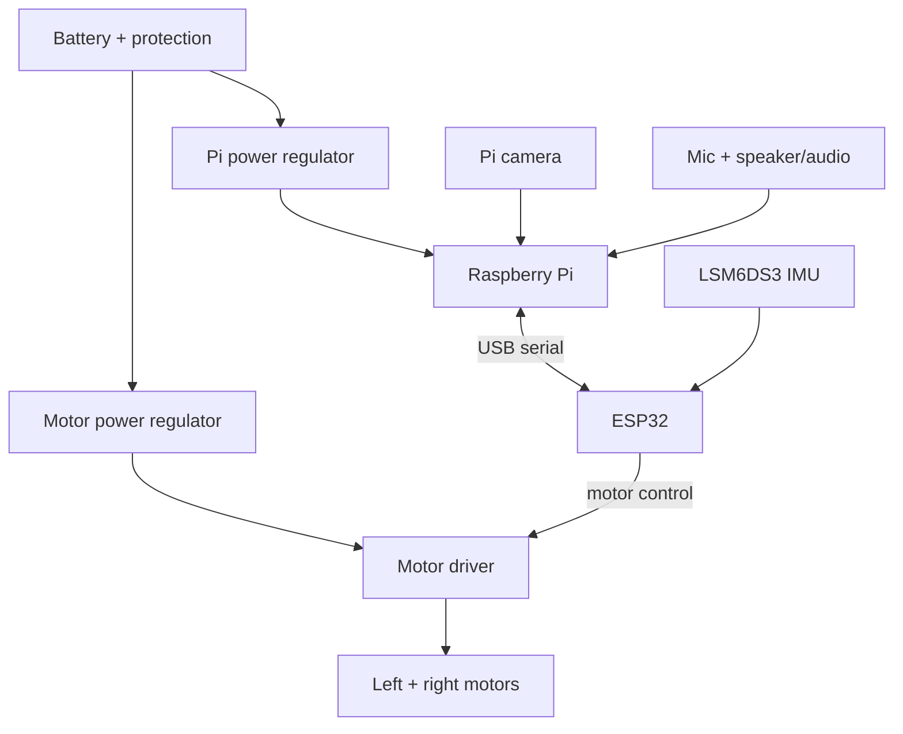

# BMO system block diagram

This is a **conceptual block diagram**, not a connection-by-connection schematic. Labels such as “regulated” deliberately omit unverified voltage, pin, and current values.

The power supplies and logic signals need a valid common reference where required. Confirm how the ESP32 is powered when plugged into the Pi, whether the driver accepts the ESP32's logic levels, motor stall current, fuse placement, and noise isolation before wiring. The IMU must be mounted rigidly near the chassis centerline; its orientation must match the firmware configuration.

## Pending schematic details

| Item | Decision needed |
| --- | --- |
| Battery | Exact chemistry, voltage range, connector, and protection |
| Pi supply | Regulator rating, output connector, and measured voltage under load |
| Motor supply | Regulator rating and motor stall current |
| Driver | Final TB6612FNG/DRV8833 or other part and its pin map |
| ESP32 ↔ IMU | I²C pins, pull-ups, IMU orientation, and mounting |
| USB serial | ESP32 USB connector, power path, and device name on Pi |
| Audio | Amplifier supply, signal wiring, speaker impedance |
| Safety | Switch, fuse, ground layout, motor disable, and tilt cutoff |
